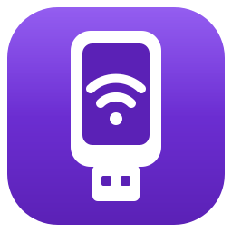
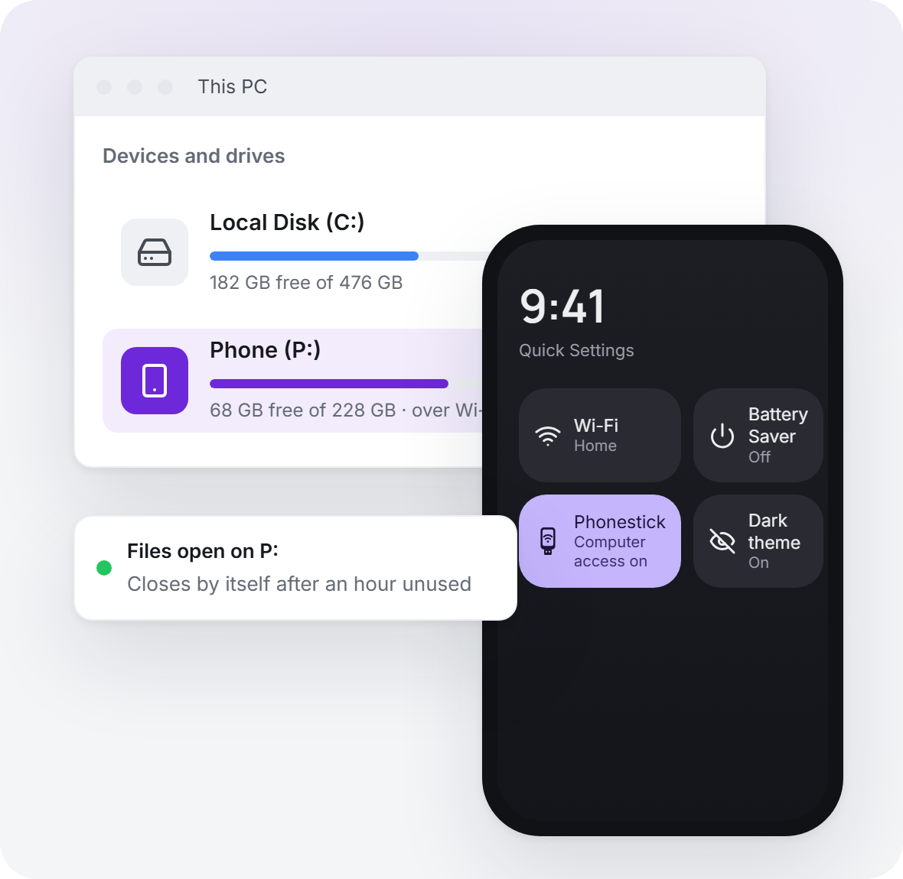
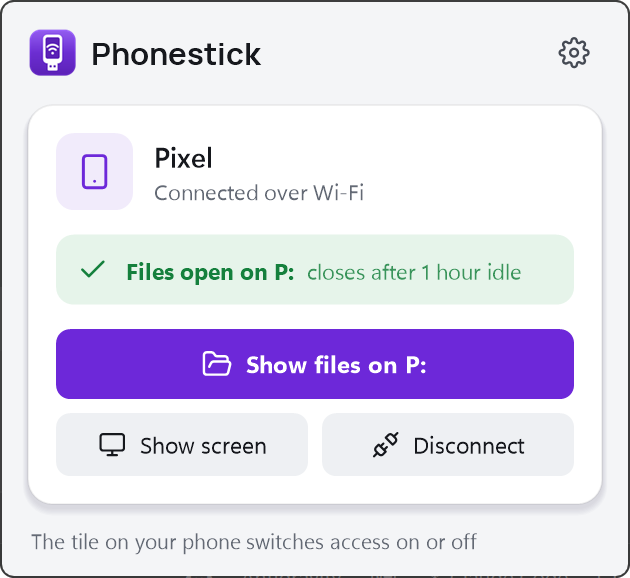

<p align="center">
  
</p>

<h1 align="center">Phonestick</h1>

<p align="center">
  <strong>Your Android phone as a USB stick. Over Wi-Fi.</strong><br>
  Only your laptop can reach it, and only while the tile is on.
</p>

<p align="center">
  <a href="https://github.com/mayerwin/Phonestick/releases/latest"></a>
  <a href="LICENSE"></a>
  
  
  
</p>

<p align="center">
  <a href="https://github.com/mayerwin/Phonestick/releases/latest/download/Phonestick.exe"><b>⬇️ Download for Windows</b></a>
  &nbsp;·&nbsp;
  <a href="https://mayerwin.github.io/Phonestick/">Website</a>
  &nbsp;·&nbsp;
  <a href="#-get-started">Get started</a>
  &nbsp;·&nbsp;
  <a href="#%EF%B8%8F-security-model">Security</a>
</p>

<p align="center">
  <a href="https://mayerwin.github.io/Phonestick/"></a>
</p>

Phonestick puts your phone's storage in Windows Explorer as drive **P:**, over your home Wi-Fi. Photos, downloads, documents, WhatsApp media: open them, copy them, drop files back. No cable, no cloud, no account, and nothing running on the phone in the background.

It also gives your computer a proper link to the phone: mirror its screen with one click, or use `adb` to install apps, read logs and fix settings.

**One `Phonestick.exe`, no installer.** A tile on the phone, a small panel in the tray, and that's it.

## ✨ Why Phonestick

<table>
  <tr>
    <td width="33%" valign="top">
      <h3>🔐 Only your computer</h3>
      The link is encrypted and needs a key only your paired laptop holds. USB debugging stays locked off, so another computer or a public charging port gets nothing.
    </td>
    <td width="33%" valign="top">
      <h3>🎚️ Only when you want</h3>
      One Quick Settings tile. On: your laptop can connect, on the Wi-Fi networks you approved. Off: nothing on the phone is listening.
    </td>
    <td width="33%" valign="top">
      <h3>🔋 Zero background cost</h3>
      The phone app is 85 KB, has no internet or location permission and never runs on its own. Android wakes it for a moment when Wi-Fi changes.
    </td>
  </tr>
  <tr>
    <td width="33%" valign="top">
      <h3>💾 A real drive letter</h3>
      Not a "media device" with half the features: a drive that every app can open and save to, like a USB stick.
    </td>
    <td width="33%" valign="top">
      <h3>🏠 Stays on your network</h3>
      Files go straight from phone to laptop over your own Wi-Fi. No relay, no upload, no mobile data.
    </td>
    <td width="33%" valign="top">
      <h3>🪶 Out of your way</h3>
      The tray app does nothing until you click it, and disconnects by itself after an hour unused (or whatever you choose).
    </td>
  </tr>
</table>

## 🖼️ Screens

<table>
  <tr>
    <td width="36%" align="center"></td>
    <td width="36%" align="center"></td>
    <td width="28%" align="center"></td>
  </tr>
  <tr>
    <td align="center"><b>The tray panel.</b> Open files, show the screen, disconnect.</td>
    <td align="center"><b>Settings, in the same panel.</b> Idle time, drive letter, startup.</td>
    <td align="center"><b>On the phone.</b> One screen, light and dark.</td>
  </tr>
</table>

## 🚀 Get started

Five minutes, once.

**On Windows**

1. Download **[Phonestick.exe](https://github.com/mayerwin/Phonestick/releases/latest/download/Phonestick.exe)** and run it. It sits in the tray.
2. That's it on this side. On first run it fetches the free helpers it builds on (scrcpy with adb, rclone and WinFsp) through winget. Windows asks once to allow WinFsp, the driver behind the drive letter.

**On the phone**

1. Settings › About phone: tap **Build number** 7 times.
2. Developer options: turn on **Disable adb authorization timeout** and **Wireless debugging**, with the phone on your home Wi-Fi.
3. Wireless debugging › **Pair device with pairing code**. On the computer: click the tray icon, the gear, then **Pair with a Wi-Fi code**.
4. Choose **Set up a phone**. Phonestick installs its phone app, grants its permission, adds its tile at the end of your Quick Settings and locks USB debugging off. Done.

No cable needed. (USB works too: turn on USB debugging, plug in and allow the computer.)

**Every day:** flip the tile on, click the tray icon, **Open phone files**. `P:` opens in Explorer.

> [!NOTE]
> Phonestick is portable. Its settings and log live in a `Phonestick.config` folder next to the exe. Delete both and nothing is left behind (apart from the helpers, which you can remove from Windows Settings › Apps).

## ⚖️ Compared

| | **Phonestick** | USB cable | Cloud sync apps | Wi-Fi file server apps |
|---|---|---|---|---|
| A real drive in Explorer | ✅ | Media device only | ❌ | Usually not |
| No cable | ✅ | ❌ | ✅ | ✅ |
| Files never leave your network | ✅ | ✅ | ❌ | ✅ |
| Nothing running on the phone when idle | ✅ | ✅ | ❌ | Server keeps running |
| Only your computer can connect | ✅ Paired keys | ✅ Physically | Your account | Often just a password |
| Screen mirroring and adb included | ✅ | Separate setup | ❌ | ❌ |

## 🛡️ Security model

Phonestick adds no new server and no new protocol. It uses Android's own Wireless debugging, which is encrypted and authenticated, and narrows it down.

| | |
|---|---|
| **Paired keys only** | Wireless debugging uses TLS with mutual authentication. A device on the same Wi-Fi can see an open port but cannot connect without a trusted key. Adding a new computer needs the 6-digit code shown on the unlocked phone. |
| **USB locked off** | The app keeps USB debugging off, so someone else's computer or a charging kiosk gets nothing. You can allow it again in the app. |
| **Approved networks only** | Access comes back by itself only on Wi-Fi networks you approved. In a café or hotel the app stays silent. |
| **Off means off** | With the tile off, Wireless debugging is off and nothing on the phone listens. The laptop closes its connection whenever you disconnect. |
| **Minimal permissions** | `WRITE_SECURE_SETTINGS` (granted once over adb, only to switch debugging), `ACCESS_NETWORK_STATE`, `RECEIVE_BOOT_COMPLETED`, `REQUEST_IGNORE_BATTERY_OPTIMIZATIONS`. No internet, location, accessibility or notification access. |
| **Private apps stay private** | The drive shows shared storage (DCIM, Download, Documents, media), like a USB cable. Other apps' private data stays out of reach. |
| **Your computer's key** | `%USERPROFILE%\.android\adbkey`. Anyone who copies it can act as your computer, so it is protected like the rest of your Windows account. Setup disables Android's 7-day authorization timeout; revoke it any time in Developer options. |

<details>
<summary><b>⚙️ How it works, in detail</b></summary>

<br>

**Why it exists.** Wireless debugging is the cleanest way to reach a phone from a computer, but Android switches it off every time Wi-Fi drops, the phone reboots or moves to another access point. Phonestick turns it back on for you, only on networks you approved and only while the tile is on. The file drive runs over that same link, so there is no extra server app, open port or account on the phone.

**On the phone**

- The tile arms or disarms access. While armed, the app turns Wireless debugging back on whenever Android turns it off, if the phone is on an approved network.
- It learns approved networks by itself: switch the tile on at home and that network is remembered. Without location permission (Android hides Wi-Fi names from apps without it) it recognises a network by its gateway and subnet.
- The first time a new access point is used, Android itself asks "Allow wireless debugging on this network?". Tick "Always allow" once per access point.
- It reacts to Android's event hooks only: a network callback (Wi-Fi connected) and JobScheduler content triggers (a debugging switch changed). An optional "Check every 15 minutes" switch (off by default) is there if access ever drops by itself anyway.
- A short event log on the app's screen shows what it did and why.
- The app only writes the debugging switches and never relies on reading them: since Android 17, apps are told developer options are off whatever their real state.

**On the computer**

- The tray app does nothing until you click it: no timers, no network, no adb.
- "Open phone files" finds the phone over mDNS, connects, and mounts it with [rclone](https://rclone.org) and [WinFsp](https://winfsp.dev). The file server is rclone itself, copied once to `/data/local/tmp/phonestick` on the phone and run through the adb shell only while the drive is mounted.
- "Show screen" opens [scrcpy](https://github.com/Genymobile/scrcpy).
- Phonestick runs its own adb server on port 5038 and shuts it down when you disconnect, so no connection stays open and other adb tools on port 5037 are not disturbed.
- Android shows a "Wireless debugging connected" notification whose channel cannot be silenced. Phonestick snoozes it right after connecting, so it does not linger (it can still flash for a second).
- `Phonestick.exe --open` opens the files from a desktop or Start menu shortcut.

</details>

<details>
<summary><b>❓ FAQ</b></summary>

<br>

**Does it need root?** No. The phone app gets one permission, granted once from your computer over adb.

**Does it use battery or data?** No mobile data: everything stays on your Wi-Fi. The phone app never runs in the background. With the tile off it does nothing at all.

**How fast is it?** Around 10 MB/s on a typical home Wi-Fi, so a 300 MB video copies in about half a minute.

**Does it work away from home?** It is made for your home network. The computer has to be on the same network, and access only comes back by itself on networks you approved.

**iPhone? Mac? Linux?** Android 11 or newer and Windows 10 or 11 for now. Both parts are small and open source if you want to port them.

**Can I still use adb myself?** Yes. With the tile on, `adb mdns services` and `adb connect` reach the phone as usual.

</details>

## 📋 Limits

- Your router must let devices on the Wi-Fi see each other (no client isolation), and Windows must let `adb.exe` through the firewall for discovery.
- Developer options must stay on. Turning them off disables all debugging.
- While access is on, switching Wireless debugging off in Settings does not stick: Phonestick turns it back on. Use the tile.
- Phones with aggressive battery managers may delay the app's wake-ups. Setup exempts it from Doze, which costs nothing since it never runs in the background.

## 🛠️ Building from source

| Part | What it is |
|---|---|
| [`android/`](android/) | The phone app: a Quick Settings tile and one screen. About 85 KB, plain Java, no libraries. |
| [`windows/`](windows/) | The tray app. .NET Framework 4.8, built into Windows 10 and 11. The phone app is embedded in the exe. |
| [`docs/`](docs/) | The website. |

```bash
# 1. Phone app (JDK 17+ and the Android SDK)
cd android && gradlew assembleRelease

# 2. Tray app (.NET SDK 8+), embeds the APK from step 1
cd ../windows && dotnet build -c Release
```

The APK is signed with the committed `sideload.keystore` (password `sideload`). That key is public on purpose, so every build installs over the previous one. It is not a store key.

## 🙏 Credits

- [scrcpy](https://github.com/Genymobile/scrcpy), [rclone](https://rclone.org) and [WinFsp](https://winfsp.dev) do the heavy lifting.
- Icons follow [Lucide](https://lucide.dev) (ISC licence). Headings use [Manrope](https://github.com/sharanda/manrope) Bold (SIL Open Font License, see `windows/Assets/Manrope-OFL.txt`).

## License

MIT, see [LICENSE](LICENSE). Not affiliated with Google or Microsoft. Android is a trademark of Google LLC.
