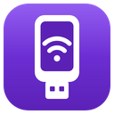
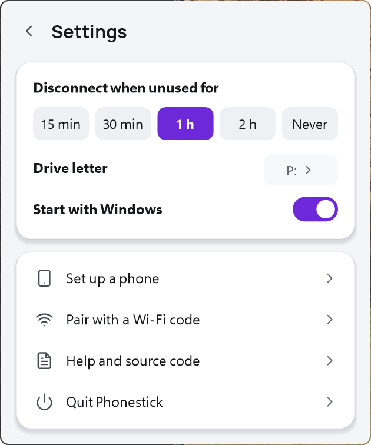
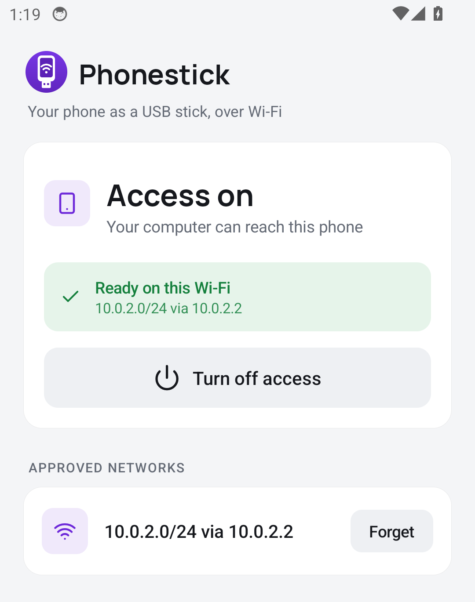

<p align="center"></p>

# Phonestick

**Your phone as a USB stick, over Wi-Fi. Only for your laptop, only when you want.**

**Website: https://mayerwin.github.io/Phonestick/**

<p align="center">
  
  
  
</p>

Phonestick shows your Android phone's storage as a drive letter in Windows Explorer, over your home Wi-Fi, without a cable. It also lets your computer reach the phone with `adb` (for scrcpy screen mirroring, logs, installing apps, fixing settings).

It is built around three promises:

- **Only your computer.** USB debugging stays switched off, so plugging the phone into any other computer or charging port gives nothing. Over Wi-Fi, only the computer you paired can connect.
- **Only when you want.** A Quick Settings tile switches access on and off. Off means nothing on the phone is listening.
- **No battery cost.** The phone app never runs in the background and has no internet or location permission. Android wakes it for a moment when Wi-Fi connects or a debugging switch changes, and that is all.

It has two parts:

| Part | What it is |
|---|---|
| `android/` | The phone app: a Quick Settings tile and a status screen. About 85 KB, plain Java, no libraries. |
| `windows/` | The tray app: click its icon for a small panel. "Open phone files" mounts the phone as `P:`, "Show screen" opens scrcpy, "Disconnect" closes everything. A few hundred KB, .NET Framework 4.8 (built into Windows 10 and 11). |

## Why

Android's Wireless debugging is the cleanest way to reach a phone from a computer: encrypted, authenticated, built in. But Android switches it off every time Wi-Fi drops, the phone reboots or moves to another access point, so in practice you have to dig into Developer options again and again.

Phonestick keeps it on for you, but only on networks you approved, and only while the tile is on. And because the file drive runs over that same adb link, there is no extra server app, open port or account on the phone.

## How it works

**On the phone**

- The tile arms or disarms access. While armed, the app turns Wireless debugging back on whenever Android turns it off, if the phone is on an approved network.
- It learns approved networks by itself: switch the tile on while on your home Wi-Fi and that network is remembered. On any other network the app does nothing and shows nothing.
- It recognises networks without location permission (Android hides Wi-Fi names from apps without it) by what the router hands out: its gateway and subnet.
- The first time a new access point is used, Android itself asks "Allow wireless debugging on this network?". Tick "Always allow" once per access point. If you dismiss it, Phonestick does not ask again on that connection.
- The app reacts to Android's event hooks: a network callback (Wi-Fi connected) and JobScheduler content triggers (a debugging switch changed). If access ever drops by itself anyway, an optional "Check every 15 minutes" switch in the app (off by default) turns Wireless debugging back on periodically while access is on.
- A short event log on the app's screen shows what it did and why, so a missed reconnection can be explained.
- USB lockdown: once set up, the app keeps USB debugging off. You can allow it again in the app. Wireless debugging keeps working with USB debugging off (checked on Android 17).
- The app only writes the debugging switches and never relies on reading them: since Android 17, apps are told that developer options, USB and Wireless debugging are off whatever their real state. Writing a value that is already set changes nothing, and a short quiet period after each write keeps the app from reacting to its own change.

**On the computer**

- The tray app does nothing until you click it: no timers, no network, no adb.
- "Open phone files" finds your phone on the network (mDNS), connects, and mounts it with [rclone](https://rclone.org) and [WinFsp](https://winfsp.dev). The file server is rclone itself, copied once to `/data/local/tmp/phonestick` on the phone and run through the adb shell only while the drive is mounted.
- The drive disconnects itself after an hour without file activity (15 minutes to 2 hours, or never, in Settings).
- Android shows a "Wireless debugging connected" notification while a computer is connected, and its channel cannot be silenced in Settings. Phonestick snoozes it from the adb shell right after connecting, so it does not linger (it can still flash for a second as the connection opens).
- Phonestick runs its own adb server on port 5038 and shuts it down when you disconnect, so no connection to the phone stays open, and other adb tools on port 5037 are not disturbed.

## Security model

- **Who can connect:** only computers whose adb key the phone trusts. During setup that is the computer you plug in and allow with "Always allow from this computer". Before setup, revoke old authorizations (Developer options > Revoke USB debugging authorizations) so your computer is the only one.
- **Wi-Fi:** Wireless debugging uses TLS with mutual authentication. A device on the same network can see that the port is open but cannot connect without a trusted key. Adding a new computer needs the 6-digit pairing code shown on the unlocked phone.
- **USB:** kept off by the app, so a stranger's computer or a public charging port gets nothing.
- **When the tile is off:** Wireless debugging is off and nothing listens.
- **Your computer's key** is `%USERPROFILE%\.android\adbkey`. Anyone who copies that file can act as your computer, so it is protected like the rest of your Windows account.
- **No expiry:** setup disables Android's 7-day authorization timeout, so your computer stays trusted. Revoke it any time in Developer options.
- **The phone app** has four permissions: `WRITE_SECURE_SETTINGS` (granted once over adb, needed to switch debugging), `ACCESS_NETWORK_STATE`, `RECEIVE_BOOT_COMPLETED` and `REQUEST_IGNORE_BATTERY_OPTIMIZATIONS` (so Doze does not hold back its wake-ups). Its command receiver only accepts senders holding `WRITE_SECURE_SETTINGS`, which the adb shell has and ordinary apps do not.
- **What it cannot reach:** files are those of the adb shell user: shared storage (DCIM, Download, Documents, Pictures, WhatsApp media and so on). Other apps' private data stays private.

## Setup

**On the computer**, install the helpers (once):

```
winget install Google.PlatformTools Rclone.Rclone WinFsp.WinFsp Genymobile.scrcpy
```

Then run `Phonestick.exe` (it adds itself to startup; untick "Start with Windows" in Settings to stop that).

**On the phone**

1. Settings > About phone: tap Build number 7 times.
2. Settings > System > Developer options: turn on "Disable adb authorization timeout" and **Wireless debugging**, with the phone on your home Wi-Fi.
3. Wireless debugging > Pair device with pairing code. On the computer, open the panel's Settings > **Pair with a Wi-Fi code** and enter the address and code.

No cable needed. (USB works too: turn on USB debugging, plug in and allow the computer.)

**Then** choose **Set up a phone** and click Start. It installs the phone app, grants its permission, adds its tile at the end of your Quick Settings, switches access on and locks USB debugging off.

## Use

- **Files:** click the tray icon, then "Open phone files". `P:` opens in Explorer. Change the letter in Settings (the gear).
- **Screen:** "Show screen" opens scrcpy.
- **Shortcut:** `Phonestick.exe --open` opens the files from a desktop or Start menu shortcut.
- **Done:** "Disconnect", or just leave it: the drive closes itself after the idle time you chose.
- **Command line:** with the tile on, `adb` reaches the phone as usual (`adb mdns services`, `adb connect`).

## Build

Phone app (JDK 17 or newer and the Android SDK):

```
cd android
gradlew assembleRelease
```

The APK is signed with the committed `sideload.keystore` (password `sideload`). That key is public on purpose: every build installs over the previous one. It is not a store key.

Tray app (.NET SDK 8 or newer):

```
cd windows
dotnet build -c Release
```

The release APK is copied next to `Phonestick.exe` so "Set up phone" can install it.

## Limits and notes

- Needs Android 11 or newer (Wireless debugging) and Windows 10 or 11.
- Your router must let devices on the Wi-Fi see each other (no client isolation), and Windows must allow `adb.exe` through the firewall for mDNS discovery.
- Developer options must stay on. Turning them off disables all debugging.
- While access is on, switching Wireless debugging off in Settings does not stick: Phonestick turns it back on. Use the tile.
- Some phones with aggressive battery managers may delay the app's jobs. Setup exempts it from Doze (`cmd deviceidle whitelist`), which costs nothing since it does not run in the background.

## Credits

- Icons in the apps follow [Lucide](https://lucide.dev) (ISC licence).
- Headings use [Manrope](https://github.com/sharanda/manrope) Bold (SIL Open Font License, see `windows/Assets/Manrope-OFL.txt`).

## License

MIT, see [LICENSE](LICENSE).
